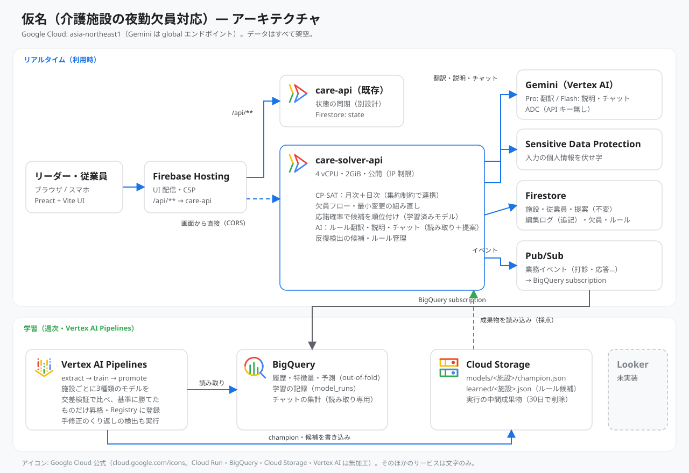

# 仮名 — 学習する、介護施設の勤務表と夜勤欠員対応

介護施設の **月次シフトと日次の時間割を、制約最適化（OR-Tools CP-SAT）で作り**、欠員が出たら **施設ごとに学習した「応諾の見込み」で補充の候補を並べる** 運用レイヤです。
リーダーの手修正のくり返しは **ルール候補として提案** し（採用・却下は人が決める）、AI は **提案までしかしません**。

> データはすべて **架空** です。ルールの数値（連続勤務・夜勤回数・必要人数など）は **すべて「デモ用の仮値」** で、法令・施設基準の数値ではありません。

## デモ

| | URL |
|---|---|
| 画面（リーダー） | https://care.yutok.dev/ （同じ内容: https://gdgoc-514203.web.app/ ）→ 左のナビ **「学習AI」**（スマホ幅では「その他」） |
| API（Swagger） | https://care-solver-api-h5p5nqo3qa-an.a.run.app/api/docs |

「学習AI」タブでできること:

1. **シフト（CP-SAT）** — 施設・月を選んで「シフトを作る」。必須ルールを守る案が、数秒〜20秒ほどで出ます。日付をクリックすると、その日の **時間帯別の業務割当**（食事・入浴・排泄介助・休憩…）が見られます。
2. **欠員と応諾見込み** — 欠員を登録すると、ルールを破らない候補が **応諾の見込み（%）と理由つき** で並びます。「直前」と「3日前」で見込みが変わるのを試せます。打診・受諾・最小変更の組み直し案も。
3. **AIアシスタント** — データを調べて答えるチャット（変更は提案だけ、実行はボタン）、言葉からルール候補（範囲を選んで保存）、手修正のくり返しから見つけたルール候補（採用／却下）。
4. **学習の状況** — 施設ごとのモデル精度、比べた候補、学習履歴、昇格できたか。

公開デモのため、書き込みの API には認証がありません（IP ごとのレート制限・同時求解の上限・AI の利用上限あり）。操作内容は他の閲覧者にも見えます。

## 構成



| Google の技術 | 使っている理由 |
|---|---|
| **Cloud Run** | CP-SAT はネイティブ依存が要り、求解は数秒〜20秒の同期処理。スケールゼロで使った分だけの課金（4 vCPU・2GiB）。 |
| **OR-Tools CP-SAT** | 必須ルールの違反ゼロを保証でき、解けないときは「どのルールを何件破れば通るか」を測れる。AI の誤りが勤務表に入らない。 |
| **Vertex AI（Gemini）** | ルールの翻訳（Pro）、説明の言い換えとチャット（Flash）。API キーは無く、サービスアカウントの認証だけ。 |
| **Vertex AI Pipelines / Model Registry** | 施設ごとに応諾予測を週次で学習。3 種類のモデルを交差検証で比べ、基準に勝てたものだけ昇格し、Registry に登録。 |
| **BigQuery** | 履歴・特徴量・out-of-fold の予測・学習の記録。チャットは決まった集計だけを読み取り専用で実行。 |
| **Firestore** | 施設・提案（不変）・手修正（追記のみ）・欠員。表を上書きする API は存在しない。 |
| **Pub/Sub** | 業務イベント（打診・応答など）を BigQuery へ。次回の学習データになる。 |
| **Sensitive Data Protection** | AI に渡す前に、氏名・電話・メールなどを伏せ字に（マスクできなければ AI を呼ばない）。 |
| **Cloud Storage** | 昇格したモデルと反復検出の候補の置き場（API が読み込んで採点）。 |
| **Firebase Hosting** | 画面の配信。CSP・プレビューチャンネルで確認してから公開。 |
| **Terraform / GitHub Actions（WIF）** | インフラをコード化。鍵ファイルなしで、テスト → ビルド → デプロイ。 |

## 実測（合成データ）

| 項目 | 結果 |
|---|---|
| 月次＋日次30日（実環境 Cloud Run） | さくら苑（34名）7〜12秒、みどりの丘（22名）約19秒、ひだまりの家（16名）約2秒。未割当 0 |
| 求解の検証 | ソルバーとは別実装の検証器で、ルール違反 0（貪欲法の初期案は 5〜21 件違反） |
| 応諾予測（交差検証 AUC） | さくら苑 0.77（基準より対数損失 +18%）、みどりの丘 0.70（+7%）、**ひだまりの家は基準に勝てず昇格せず**（164件では不足） |
| 手修正のくり返しの検出 | 月次は隠れたルール 9 件中 7 件を再現、日次は 7 件中 7 件。誤検出は 0 件 |
| AI（本物の Gemini） | ルール翻訳 22/22（Pro）、チャットは期待どおりのツールを呼べた 17/17、返答に元データに無い数字なし |
| テスト | solver-api 70 件（`cd solver-api && python -m pytest -q`） |

**限界**: 精度は合成データで「埋め込んだ傾向を再現できたか」を示すもので、実運用での精度ではありません。評価の問い（翻訳 22 件・チャット 17 問）は開発者が書いたもので、独立した検証ではありません。順位付けの効果は AUC・対数損失でしか測っていません（本物の打診での A/B はありません）。

## 設計の考え方

- **AI は提案、確定は人**: チャットのツールは読み取りと「提案」だけ。表・欠員・ルールを書き換えるツールは存在しない。
- **意味境界**: ルールは 5 種類の型（必要人数・希望・連なり・回数・偏り）に限る。Gemini はこの型を満たす下書き 1 本しか出せず、範囲（この日だけ／この人の曜日／全員…）と期限は人が選ぶ。
- **上書きしない**: 提案は不変で追記、手修正は追記のみ。現状の表は「提案＋手修正」から導く。
- **正直な gate**: 基準に勝てないモデルは昇格させない。ひだまりの家は、データが貯まるまで従来の順位付けのまま。

## 動かす

```bash
# 合成データ（架空・シード固定）
python3 scripts/synth/generate.py --out scripts/synth/out

# API のテスト（GCP には接続しない）
cd solver-api && python3 -m venv .venv && .venv/bin/pip install -r requirements-dev.txt && .venv/bin/python -m pytest -q

# 画面（開発サーバー）
npm install && npm run dev        # http://localhost:5173 → 左のナビ「学習AI」
```

デプロイ・学習パイプライン・評価の手順: [solver-api/README.md](solver-api/README.md)、[solver-api/pipelines/README.md](solver-api/pipelines/README.md)。
インフラ: [infra/](infra/)（Terraform）。CI/CD の定義: [.github/workflows/](.github/workflows/)（この提出用リポジトリでは Actions が使えないため、開発用リポジトリで稼働）。
設計と P0〜P5 の結果（測定値・限界・既知の不具合の修正記録）: [docs/ARCHITECTURE_v0.3_cpsat.md](docs/ARCHITECTURE_v0.3_cpsat.md)。

## 注意・出典

- **Firebase の Web API キー**（`public/sync.js`）は、クライアントに置く前提の公開キーです。公開サイトの 3 つのリファラーと、認証用の 2 つの API だけに制限しています（秘密情報ではありません）。
- ルールの考え方（強度の 3 段階、二度解きによる不充足の説明、手修正のくり返しの検出）は、チームメンバー（久保 公行）が作成した [ben1san/df-hack26](https://github.com/ben1san/df-hack26) の設計の考え方を参考にしています。コードは複製せず、介護施設向けに独自に実装しています。
- 構成図のアイコンは Google Cloud 公式（[cloud.google.com/icons](https://cloud.google.com/icons)、Cloud Run・BigQuery・Cloud Storage・Vertex AI を無加工で使用）。そのほかのサービスは文字のみ。
- 実在の人物・施設・個人情報は含みません。

## ライセンス

[MIT License](LICENSE)
